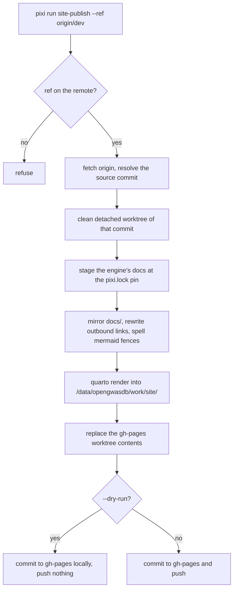

How this site is built, previewed, published and extended. It is one Quarto
website over this repository's `docs/` and opengwasdb's docs, rendered on the
host where the data lives, and published from the `gh-pages` branch at
<https://blog.opengwas.io/opengwasdb-stores/>.

## The commands

| Command | What it does |
| --- | --- |
| `pixi run site` | Stage both repositories' docs, render the site, and check every served path. |
| `pixi run site-preview` | The same staging, then Quarto's live-reloading preview on <http://localhost:4200>. |
| `pixi run site-publish --dry-run` | Render a clean checkout of `origin/dev` and commit it to `gh-pages` **without pushing**. |
| `pixi run site-publish` | The same, then push `gh-pages`. The owner runs this. |
| `pixi run docs` | Refresh a report: render its `.qmd` and copy the HTML to the name the site serves. |

Nothing is rendered in CI: every page repeats the site's navigation, so committed
output would make parallel pull requests conflict.

## Where a render puts things

| Path | What |
| --- | --- |
| `/data/opengwasdb/work/site/<checkout>/_site` | The rendered site (`$OPENGWASDB_SITE_OUT` overrides it). |
| `/data/opengwasdb/work/site/<checkout>/_stage` | The mirror of `docs/` the render reads (`$OPENGWASDB_SITE_ROOT` moves the work root). |
| `/data/opengwasdb/work/site/<checkout>/_preview` | The synced copy `site-preview` serves; Quarto renders inside it. |
| `/data/opengwasdb/work/site/opengwasdb.git` | The bare clone the engine's docs are staged from (`$OPENGWASDB_SITE_ENGINE_CLONE` overrides it). |
| `docs/opengwasdb/` | The engine's docs staged at the pinned revision. Git-ignored, regenerated on every render. |
| `docs/glossary.md` | `CONTEXT.md`, staged as the glossary page. Git-ignored, regenerated. |

Nothing the site build writes goes under `/home` or `/tmp`.

The render reads a mirror of `docs/`, not `docs/` itself. That is deliberate:
the mirror is where the link rewrite and the Mermaid spelling happen, so no
source file is ever edited, and `docs/` stays readable on GitHub.

## Publishing

`site-publish` renders a clean detached worktree of the ref, so nothing depends on
an uncommitted change in your checkout, and commits the output to a `gh-pages`
worktree with a message naming the source commit. It creates `gh-pages` as an
orphan branch when it is absent, so the published branch shares no history with a
source branch.

It refuses a ref that is not on the remote, and it refuses a `gh-pages` worktree
with uncommitted changes, because a publish replaces what that worktree holds.



The default ref is `origin/dev` until the cutover, after which it becomes
`origin/main`.

## Adding a page

1. Add a Markdown file under `docs/` — `docs/my-page.md` — with a single `#`
   heading as its title. It is served at `/my-page.html`.
2. If it belongs to a section, add it to `docs/_quarto.yml`: the navbar for a
   section index, or a `sidebar`'s `contents`. A glob such as `adr/*.md` already
   covers a new ADR, so most pages need no configuration.
3. Use ` ```mermaid ` for a diagram and it renders as one, as it does on GitHub;
   `dot` files under `docs/diagrams/` are served as the files they are.
4. Link to a sibling with its relative path (`../spec/release-config.md`). Link to
   anything outside `docs/` with the relative path you would use on GitHub — the
   build rewrites it to that file on GitHub at the commit being rendered. A link
   the build rewrites is reported if the commit does not have the target.
5. **Never move or rename a page that is already published.** A reader's link
   would break. If a page must move, keep the old path as an `aliases` entry in
   the new page's YAML front matter; Quarto then writes a redirect page there,
   which the served-path check counts as an alias rather than a missing path.
6. Historical reports are not rendered: their source `.qmd` lives in
   `docs/reports/`, and `pixi run docs` renders it and copies the self-contained
   HTML to the root name the site serves. Do not add `.qmd` files to `docs/`
   outside `reports/` unless the page really must execute code at render time.

## Checking a change

`pixi run site` ends with the served-path check: every path `origin/main` serves
under `docs/` today must be present or aliased in the output, and a missing path
fails the build. Run it before opening a pull request that touches `docs/`.

You can run the check on its own against an existing render:

```bash
pixi run -e dev python3 -m project_site.urlcheck \
  --git-rev origin/main \
  --output /data/opengwasdb/work/site/<checkout>/_site
```
