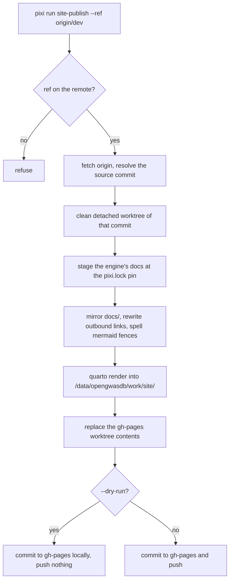

How this site is built, previewed, published and extended. It is one Quarto
website over this repository's `docs/` and opengwasdb's docs, rendered on the
host where the data lives, and published from the `gh-pages` branch at
<https://blog.opengwas.io/opengwasdb-stores/>.

## The commands

| Command | What it does |
| --- | --- |
| `pixi run site` | Collect the site's data, stage both repositories' docs, render, and check every served path. |
| `pixi run site-preview` | The same staging, then Quarto's live-reloading preview (on <http://localhost:4200>, or the next free port). |
| `pixi run site-publish --dry-run` | Render a clean checkout of `origin/main` and commit it to `gh-pages` **without pushing**. |
| `pixi run site-publish` | The same, then push `gh-pages`. The owner runs this. |
| `pixi run docs` | Refresh a report: render its `.qmd` and copy the HTML to the name the site serves. |

Nothing is rendered in CI: every page repeats the site's navigation, so committed
output would make parallel pull requests conflict.

## Where a render puts things

| Path | What |
| --- | --- |
| `/data/opengwasdb/work/site/<checkout>/_site` | The rendered site (`$OPENGWASDB_SITE_OUT` overrides it). |
| `/data/opengwasdb/work/site/<checkout>/_stage` | The mirror of `docs/` the render reads, with the collected data and the generated pages in it (`$OPENGWASDB_SITE_ROOT` moves the work root). |
| `/data/opengwasdb/work/site/<checkout>/_preview` | The synced copy `site-preview` serves; Quarto renders inside it. |
| `/data/opengwasdb/work/site/opengwasdb.git` | The bare clone the engine's docs are staged from (`$OPENGWASDB_SITE_ENGINE_CLONE` overrides it). |

Nothing the site build writes goes under `/home` or `/tmp`, and nothing is
written into the checkout.

The render reads a mirror of `docs/`, not `docs/` itself. That is deliberate:
the mirror is where the link rewrite, the Mermaid spelling and the staged engine
docs and glossary live, so no source file is ever edited, `docs/` stays readable
on GitHub, and two renders — of different checkouts, or of one checkout into two
outputs — never collide. `docs/opengwasdb/` holds the engine's docs at the pinned
revision and `docs/glossary.md` is `CONTEXT.md`, both inside the mirror.

## Publishing

`site-publish` renders a clean detached worktree of the ref, so nothing depends on
an uncommitted change in your checkout, and commits the output to a `gh-pages`
worktree with a message naming the source commit. It creates `gh-pages` as an
orphan branch when it is absent, so the published branch shares no history with a
source branch.

It refuses a ref that is not on the remote, and it refuses a `gh-pages` worktree
with uncommitted changes, because a publish replaces what that worktree holds.



The default ref is `origin/main`: every merge lands there and is a version
(#386). Before the cutover, name `--ref origin/dev` explicitly.

## The data pages

Five pages are generated from the site's own data rather than written by hand:
the [Overview](index.qmd), [Stores](stores.qmd), [Epics](epics.qmd),
[Trends](trends.qmd) and [Changelog](changelog.qmd), with one page per epic and
one per registered Store beside them
([`src/project_site/pages.py`](../src/project_site/pages.py), #391).

- `pixi run site` and `site-publish` **collect the data themselves** before the
  render, into the render's own `_stage/_data`, from the `stores/` and
  `docs/_epics/` of the checkout being rendered. `$OPENGWASDB_SITE_DATA` names a
  directory collected already, and then nothing is collected.
- `docs/_quarto.yml` names `docs/pre-render.sh` as the project's `pre-render`
  hook. Quarto runs it inside the mirror before rendering, so the generator
  writes the pages where the render reads them and never into the checkout. The
  commit being rendered reaches it as `$OPENGWASDB_SITE_COMMIT`, which is what a
  generated link to a file outside `docs/` names.
- The five section pages are committed as short stubs that say they are
  generated: their published paths stay (`index.html`, `stores.html`), and a
  render replaces them. The per-epic and per-Store pages are git-ignored
  (`docs/epics/`, `docs/stores/`).
- A page never fails because a source is missing: it shows a notice naming the
  source, its error and when it was collected. `docs/spec/project-site.md` is
  the contract between the data and the pages.
- An epic page is written for every epic the board lists **and** for every valid
  epic record: a record outlives the board, so when `gh` is offline the
  record-backed page is still generated, carrying the board's unavailable notice,
  and a page that has a record is never removed as stale.
- A yardstick trend is drawn within one workload. Results are keyed by
  `workload_sha256` (`workload_id` where the hash is missing), each series and
  each matrix table names the workload it measured, and no line or row spans two
  workloads, so a trend shows a change in the code rather than in the benchmark.
  A point measured in the Veeam backup window (`veeam_window: true`) is ringed in
  the figure and marked `†` in the table, with a caveat saying its timing is not
  comparable.

## Going live

The first real publish creates `gh-pages`; GitHub Pages keeps serving the legacy
`main`/`docs` deployment until its source is switched. That switch is the owner's
step, taken after the first real `pixi run site-publish`:

```bash
gh api -X PUT repos/opengwas/opengwasdb-stores/pages \
  -f 'source[branch]=gh-pages' -f 'source[path]=/'
```

It sets Pages to build from the `gh-pages` branch at `/`, which is where
`site-publish` puts the rendered site.

## Adding a page

1. Add a Markdown file under `docs/` — `docs/my-page.md` — with a single `#`
   heading as its title. It is served at `/my-page.html`.
2. If it belongs to a section, add it to `docs/_quarto.yml`: the navbar for a
   section index, or a `sidebar`'s `contents`. A glob such as `adr/*.md` already
   covers a new ADR, so most pages need no configuration.
3. Use ` ```mermaid ` for a diagram and it renders as one, as it does on GitHub;
   `dot` files under `docs/diagrams/` are served as the files they are. Quarto
   renders a Mermaid cell only in a `.qmd`, so a `.md` page holding one is staged
   as `.qmd`, its published `.md` path is filled in after the render, and links to
   it reach its rendered page. Add it to the sidebar as `<name>.qmd`.
4. Link to a sibling with its relative path (`../spec/release-config.md`). Link to
   anything outside `docs/` with the relative path you would use on GitHub — the
   build rewrites it to that file on GitHub at the commit being rendered. A link
   the build rewrites is reported if the commit does not have the target.
5. **Never move or rename a page that is already published.** A reader's link
   would break. If a page must move, keep the old path as an `aliases` entry in
   the new page's YAML front matter; Quarto then writes a redirect page there,
   which the served-path check counts as an alias rather than a missing path.
6. Historical reports are not rendered: their source `.qmd` lives in
   `docs/reports/`, and `pixi run docs` renders it and copies the self-contained
   HTML to the root name the site serves. Do not add `.qmd` files to `docs/`
   outside `reports/` unless the page really must execute code at render time.
7. A page that is computed from the site's data is not written by hand: add it
   to `src/project_site/pages.py` (`SECTION_PAGES` for a section, or one of the
   per-epic and per-Store writers) and commit a stub with its published path at
   `docs/`, as the five data pages above do. Do not edit a generated page — a
   render replaces it. A page holding a chart is written as a `{=html}` block,
   not an inline SVG in a table cell: Pandoc drops an SVG's children there.
8. A fact is data, never markup, and that includes a fact in a code span: a
   version tag is free text, so it may hold a backtick, a `|` or a `<b>`. Write
   one with `pages._code`, which uses a plain code span when the value cannot
   close it or cut its table cell and an HTML `<code>` with escaped text
   otherwise; a hand-written `` `{value}` `` fence breaks on the first one that
   does.

## Checking a change

`pixi run site` ends with the served-path check: every path `origin/main` serves
under `docs/` today must be present or aliased in the output, and a missing path
fails the build. Run it before opening a pull request that touches `docs/`.

You can run the check on its own against an existing render:

```bash
pixi run -e dev python3 -m project_site.urlcheck \
  --git-rev origin/main \
  --output /data/opengwasdb/work/site/<checkout>/_site
```
